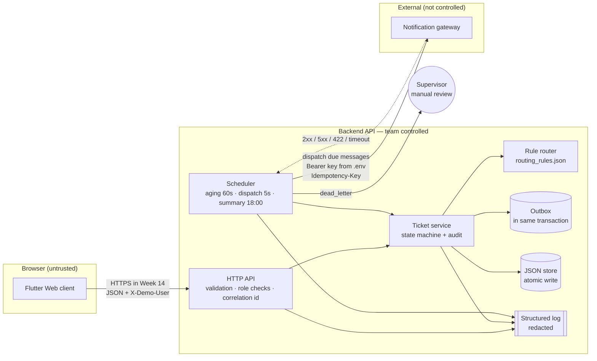
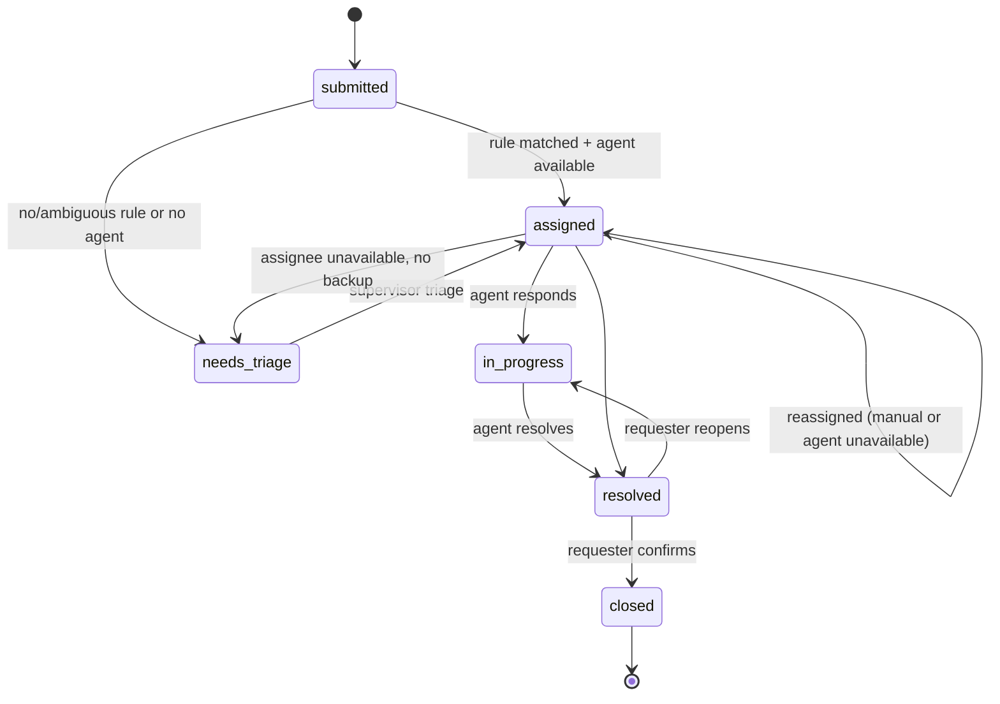
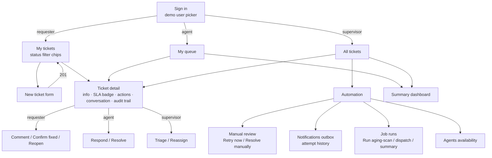

# Week 13 — Automation Foundation (SA7)

**Project 16: IT Help Desk Ticket Router**
PFEBSIT 002 Integrative Programming and Technologies 2 · Flutter Web client + Dart backend API

| | |
|---|---|
| Student | _[your name]_ · _[ID number]_ · _[section]_ |
| Build | backend `0.13.0`, frontend `0.13.0+1` |
| Environment | Windows 10 Home 19041 · Dart 3.13.7 · Flutter 3.47.8 (stable) · Chrome-based browser |
| Data | Fictional seed users only, `.test` mail domains. No production services or real records. |
| Evidence run | 2026-11-04 06:19 UTC, `evidence/week13_run.md` (39 requests, 17 s) |

> **Before you submit:** fill in the placeholders above, read every section and make sure you can explain it, and complete the AI-use acknowledgement and reflection (section 12) **in your own words**. The instructor may ask you to reproduce any test or explain any code path.

---

## 1. Workflow boundary

**Decision question:** *How do we route help desk tickets to the right agent consistently, keep them from silently ageing past their target time, and make sure notification failures never block or lose work — without removing human judgement for unclear or failed cases?*

### Actors and authority

| Actor | Can do | Authority |
|---|---|---|
| Requester (student / employee) | Submit, comment, confirm fix, reopen | Owns their tickets only |
| Agent (network, software, hardware, accounts team) | Respond, resolve tickets assigned to them or their team | Their team's queue |
| Supervisor | Triage, reassign, set agent availability, handle failed notifications, run jobs | **Approval authority** for exceptions |
| `system:router` | Categorise + assign on submission | Rules in `config/routing_rules.json` |
| `system:aging` | SLA alerts, escalation, auto-reassignment | Scheduled job |
| Notification gateway | Deliver messages | External dependency (mock in this environment) |

### Scope

| | |
|---|---|
| **Trigger** | (a) Ticket submitted → routing (event). (b) State change → notification queued (event + 5 s poll). (c) Aging scan every 60 s (schedule). (d) Daily summary at 18:00 local (schedule). |
| **Trusted inputs** | Server-side user record (role, team, availability) — never the role sent by the browser. Ticket text is **untrusted** and only used for keyword matching. |
| **Validation** | Title 5–120, description 10–2000, category in list, priority in list, unknown fields rejected, body ≤ 16 KB. |
| **Processing** | Categorise → set priority/SLA → pick least-loaded available agent → assign or send to triage → queue notifications → age → alert/escalate/reassign → summarise. |
| **Outputs** | Ticket state + audit trail, notifications, job-run records, daily summary, structured logs. |
| **Human approval points** | Unroutable/ambiguous tickets (triage), reassignment, dead-lettered notifications (retry or resolve with note), closure needs the requester's confirmation. |
| **Explicit non-goals (Week 13)** | Real authentication (Week 14), real email/SMS provider, file attachments, knowledge base, chat, multi-tenant, mobile build, production deployment. |

### Boundary and data-flow diagram



Trust boundaries: browser → API (all input validated server-side), API → gateway (secret only on server, every call has a timeout). Sensitive data: requester email addresses stay on the server; logs and API responses show user IDs or masked addresses only.

### Ticket state machine



---

## 2. Trigger decision (pattern comparison + ADR)

### Pattern comparison matrix

| Job | Option A | Option B | Chosen | Why |
|---|---|---|---|---|
| **Routing on submit** | Scheduled batch every N minutes | **Event: handled inside the submit transaction** | B | Requester sees the assignee immediately; a ticket can never be stored without a routing decision; no missed-event risk. Cost: routing must stay fast (it is pure in-memory rules, < 1 ms). |
| **Notifications** | Send inline during the request | **Transactional outbox + dispatcher (event nudge + 5 s poll)** | B | Inline sending would make ticket creation fail or hang when the gateway is down. Outbox saves the message with the state change, survives restarts, and enables bounded retry. Cost: delivery is asynchronous (seconds). |
| **SLA aging** | Per-ticket timers | **Scheduled scan every 60 s** | B | Timers are lost on restart and hard to observe; a scan is restart-safe, idempotent (alerts are recorded on the ticket) and leaves a job-run record. Cost: alert latency up to 60 s — acceptable against 4–72 h SLAs. |
| **Daily summary** | Manual export (current process) | **Scheduled at 18:00 local + on-demand** | B | Removes the manual step; guarded so it runs once per day. |
| **Reassignment** | Real-time on availability change | **Next aging scan** | B | Keeps one code path for "fix assignments"; supervisor can also reassign manually at once. |

Rejected outright: polling the gateway for delivery status (not needed — synchronous 2xx is the receipt), and putting the gateway API key in the Flutter app (public clients cannot keep secrets).

### ADR-001 — Transactional outbox with bounded retry for notifications

- **Context:** Ticket notifications go to an external gateway that can be slow, down, or reject a recipient. Staff currently notify by hand.
- **Decision:** Every state change writes its notification into an outbox *in the same store transaction*. A dispatcher sends due messages (event-triggered on enqueue, plus a 5 s poll), classifies the outcome, retries transient failures with exponential backoff + jitter up to 4 attempts, and dead-letters permanent failures or exhausted retries for supervisor review.
- **Alternatives:** (1) Send inline in the HTTP request — rejected: couples ticket creation to gateway health. (2) Fire-and-forget async call — rejected: messages are lost on crash and failures are silent.
- **Consequences:** + No lost messages, no blocked workflow, visible failures. − Delivery is eventually consistent; a "sending" state must be recovered on restart; someone must own the manual-review queue (supervisor); the outbox grows and needs retention later.
- **Evidence:** §7 (MSG-00006 recovered after two 503s; MSG-00008 recovered after a timeout; MSG-00010 dead-lettered on 422), tests in `backend/test/outbox_test.dart`.
- **Review condition:** Revisit if volume exceeds what a single process can dispatch (≈ hundreds/minute) or if a real provider offers delivery webhooks.

---

## 3. Flutter Web screen flow



| Concern | How it is handled | Where |
|---|---|---|
| Reusable widgets | `AsyncBody` (loading / error+retry / empty / data), `StatusChip`, `SlaBadge`, `MessageView` | `frontend/lib/src/widgets.dart` |
| Validation | Same limits as server; server 422 field errors are shown on the matching field; errors update while typing after first submit | `new_ticket.dart` |
| Double submit | Button disabled while sending + `Idempotency-Key` per form | `new_ticket.dart`, `api_client.dart` |
| States | loading, success snackbar, empty, validation, 401, 403, 404, 409, network, 5xx (generic text + correlation ref) | `api_client.dart` `ApiFailure.userMessage` |
| Responsive | Navigation rail ≥ 800 px, bottom bar below; ticket detail two columns ≥ 900 px; `Wrap` for chips/fields | `shell.dart`, `ticket_detail.dart` |
| No secrets in client | Only `API_BASE_URL` via `--dart-define`; gateway key exists only in backend `.env` | `api_client.dart` |
| Accessibility | Labelled fields, tooltips, semantics label on status chips, keyboard-operable Material controls | throughout |

Screenshots: `evidence/screenshots/` (desktop and 375 px phone width). Two layout bugs were found by widget tests and fixed (category dropdown overflowing at narrow widths; sign-in card overflowing on short screens) — see §10.

---

## 4. API contract

Full contract: [`docs/openapi.yaml`](openapi.yaml). Summary:

| Method & path | Role | Purpose |
|---|---|---|
| `GET /health` | public | Store + gateway status, outbox pending / in-flight / dead-letter counts |
| `POST /api/v1/tickets` | requester | Submit; routes immediately; `Idempotency-Key` supported → **201** |
| `GET /api/v1/tickets[?status=]` | all | List scoped to caller |
| `GET /api/v1/tickets/{id}` | all | Detail (**404** for "not yours" as well as "missing") |
| `POST …/{id}/responses` · `/resolve` | agent (assignee) / supervisor | Work the ticket |
| `POST …/{id}/confirm` · `/reopen` | requester (owner) | Close or reopen |
| `POST …/{id}/reassign` · `/triage` | supervisor | Human decisions |
| `PATCH /api/v1/agents/{id}/availability` | supervisor | Triggers auto-reassignment on next scan |
| `GET /api/v1/automation/notifications[?status=]` | supervisor | Outbox, addresses masked |
| `POST …/notifications/{id}/retry` · `/dismiss` | supervisor | Manual handling of dead letters |
| `GET /api/v1/automation/runs` · `POST …/jobs/{job}/run` | supervisor | Job history / run now (**409** if already running) |
| `GET /api/v1/summaries/latest` | agent, supervisor | Support summary |
| `POST /api/v1/dev/clock/advance` | supervisor, **development only** | Demonstrate SLA aging without waiting hours |

Error shape (all errors): `{"error": {"code", "message", "details"?, "correlationId"}}`. Codes: 400, 401, 403, 404, 409, 413, 422, 500.

---

## 5. Retry and recovery policy

### Failure taxonomy

| Failure | Example | Class | Handling |
|---|---|---|---|
| Gateway 5xx, 408, 425, 429 | 503 service_unavailable | **Transient** | Retry with backoff |
| Timeout (> 3 s) | slow gateway | **Transient** | Retry with backoff |
| Connection refused / reset | gateway down | **Transient** | Retry with backoff |
| Gateway 4xx (other) | 422 recipient_rejected, 401 bad key | **Permanent** | Dead-letter immediately → manual review |
| Retries exhausted | 4 transient failures | **Permanent (operational)** | Dead-letter → manual review |
| Business rule | no matching rule / no agent available | **Business** | `needs_triage` → supervisor |
| Invalid request | bad JSON, failed validation | **Client** | 400 / 422, nothing saved |
| Crash mid-send | process killed while `sending` | **Recovery** | On start, `sending` → `retrying`; gateway de-duplicates by idempotency key |
| Exception inside a transaction | unknown agent on reassign | **Integrity** | Transaction rolled back to snapshot; store unchanged |

### Policy (from `.env`)

| Setting | Value |
|---|---|
| Max attempts | 4 (`RETRY_MAX_ATTEMPTS`) |
| Backoff | e = min(30 s, 2 s × 2^(n−1)); delay = e/2 + random(0, e/2) ("equal jitter") → ~1–2 s, 2–4 s, 4–8 s |
| Per-attempt timeout | 3 s (`GATEWAY_TIMEOUT_MS`) |
| Dispatcher | on enqueue + every 5 s, batch 20, overlap guard (one dispatcher at a time) |
| Idempotency | Key `ticketId:event:recipient:occurrence`; outbox refuses duplicates; gateway ignores repeated keys |

### Recovery runbook (supervisor / maintainer)

1. **Automation → Manual review** lists every dead-lettered notification with its attempt history.
2. Read `deadLetterReason`:
   - `permanent_rejection` (e.g. 422 recipient rejected): contact the person another way, request the contact record be fixed, then **Resolve manually** with a note — or **Retry now** after the address is corrected.
   - `retries_exhausted`: check `GET /health` → `notificationGateway`. When it is `ok`, press **Retry now** (fresh budget of 4 attempts; old attempts stay in the history).
3. For a ticket in **needs_triage**: open it, choose category + priority → it is assigned to the least-loaded agent.
4. After a crash: just restart the server. Log line `outbox.recovered_in_flight` lists messages that were resumed.
5. Search logs by `correlationId` (shown to users as "ref …" on server errors) to trace one request end-to-end.

---

## 6. Structured logs

JSON lines in `backend/logs/app.log` (and stdout). Every line has `ts`, `level`, `event`, and `correlationId` where one exists. Fields named `email`, `address`, `to`, `title`, `description`, `message`, `body`, `token`, `password`, `authorization`, `secret`, `apiKey` are replaced with `[REDACTED]` by the logger itself. The evidence log (`evidence/app_structured.log`, 213 lines) contains **0** `@` characters — no addresses leaked.

```json
{"ts":"2026-11-04T06:19:09.681090Z","level":"WARN","event":"notification.retry_scheduled","messageId":"MSG-00006","ticketId":"TKT-0002","notificationEvent":"ticket.received","attempt":1,"maxAttempts":4,"httpStatus":503,"errorCode":"service_unavailable","durationMs":6,"correlationId":"ev13-0009-73149638","retryInMs":1915}
```

Main events: `ticket.submitted`, `routing.decided`, `ticket.assigned|reassigned|needs_triage|status_changed`, `outbox.enqueued`, `notification.sent|sent_after_retry|retry_scheduled|dead_lettered|manual_retry|dismissed`, `sla.warning|breached`, `job.completed|skipped_overlap|failed`, `summary.generated`, `http.request`, `api.unhandled`.

---

## 7. Failure evidence

All from `evidence/week13_run.md` (generated by `backend/tool/run_evidence.dart` against the running server and mock gateway; faults injected through the gateway's `/admin/fault`).

### 7.1 Successful normal path (TKT-0001)
Ana submits "Wifi keeps dropping in Room 204" → `keyword match: network (1 hit)` → assigned to **agent-carla** (least loaded, tie broken by ID) → Carla responds (`in_progress`) → resolves → Ana confirms → **closed**. Re-sending the same form with the same `Idempotency-Key` returned **TKT-0001 again** instead of a duplicate.

### 7.2 One recovered transient failure (MSG-00006)
**Predicted:** gateway returns 503 to the next 4 calls; TKT-0002 queues 2 notifications, so each fails twice and succeeds on attempt 3; nothing delivered twice.
**Observed:**

| Time (UTC) | Event | Detail |
|---|---|---|
| 06:19:09.638 | `outbox.enqueued` | MSG-00006 `ticket.received` → req-ben |
| 06:19:09.681 | `notification.retry_scheduled` | attempt 1/4, **503**, retry in 1915 ms |
| 06:19:14.458 | `notification.retry_scheduled` | attempt 2/4, **503**, retry in 2794 ms |
| 06:19:19.446 | `notification.sent_after_retry` | attempt 3/4, **202** |

MSG-00007 (`ticket.assigned`) followed the same path. A separate **timeout** case (MSG-00008: gateway delayed 5 s against a 3 s timeout) was recorded as `transient_failure timeout 3008 ms → sent (202)`. The gateway's delivered list shows each idempotency key **once** (23 messages).

### 7.3 One permanent failure routed for human action (MSG-00010)
**Predicted:** Gio's mailbox (`…@invalid.test`) is rejected; no retry; supervisor sees it; the ticket still proceeds.
**Observed:** `permanent_failure (422) recipient_rejected` on attempt **1** → `notification.dead_lettered` with `reason: permanent_rejection, action: manual_review_required`. TKT-0004 was still **assigned to agent-faith** (the workflow was not blocked). The manual-review list returned 1 item; the supervisor resolved it with the note *"Mailbox decommissioned; requester informed by phone. Contact update requested."* → `dismissed`.

### 7.4 Other automation behaviour

| Scenario | Result |
|---|---|
| Unroutable ticket (TKT-0005, no keyword) | `needs_triage`, supervisor notified → triaged to software → **agent-dan** |
| Agent marked unavailable (TKT-0006) | Next aging scan: `reassigned: 1` → moved from agent-carla to **agent-noel** |
| SLA (TKT-0007, high = 8 h) | +6.5 h → `warnings: 2` (81%); re-run → `warnings: 0` (no duplicates); +2 h → `breaches: 2`, `escalated: true`; audit: submitted, status_changed, sla_warning, sla_breached |
| Support summary | Generated on demand and by the scheduler; counts by status, category, agent, breaches, notification health |
| Adverse requests | 422 (field details + "Unexpected fields: role"), 400 malformed JSON, 401 no/unknown identity, 403 agent → supervisor endpoint, 404 other user's ticket, 409 confirm before resolved |

---

## 8. Secure automation and protected configuration (checklist)

| Control | Status | Evidence |
|---|---|---|
| Secrets outside source | ✅ Gateway key only in `backend/.env` (git-ignored); `.env.example` has a placeholder; server refuses to start without it | `config.dart`, `.gitignore` |
| Secrets not logged | ✅ Startup log prints `gatewayApiKey: "[set]"`; logger redacts sensitive field names | `config.dart describe()`, `logger.dart` |
| No secrets in the Flutter build | ✅ Only `API_BASE_URL` | `api_client.dart` |
| Least privilege | ✅ Role from server record; per-endpoint role checks; requesters/agents scoped to own/team tickets | `tickets.dart canView`, `api.dart` |
| Input validation | ✅ Length, enums, unknown-field rejection, 16 KB limit, idempotency-key format | `validateCreate`, `_body` |
| Safe errors | ✅ Generic 500 with correlation id; details only in protected log | `_errors` middleware |
| Data minimisation | ✅ Notification text = ticket ID + status only; addresses masked in API; no description in logs | `outbox.dart _templates`, `maskAddress` |
| CORS | ✅ Only `localhost:*` / `127.0.0.1:*` origins; others get 403 on preflight | `api_test.dart` |
| Dev-only features gated | ✅ Clock endpoint 404 unless `APP_ENV=development` | `api.dart` |
| Auditability | ✅ Every state change in ticket history with actor + correlation id; job runs stored | `AuditEvent`, `JobRun` |
| **Not yet** | ⏳ Real authentication, HTTPS, encrypted store, rate limiting — **Week 14** | — |

---

## 9. Observability, performance and maintainability note

**Measured (evidence run, local machine):** 34 API calls, median **16 ms**, p95 **41 ms**, max **52 ms**. Aging scan over 5–7 tickets: **0–15 ms**. Gateway calls: 4–7 ms; timeout case 3008 ms (bounded by the 3 s limit, and it ran in the background dispatcher, so no user request waited on it).

**Observability:** correlation ID on every request, log line, audit event and outbox message; `/health` reports gateway reachability and outbox pending / in-flight / dead-letter counts; job runs recorded with duration and counts; the summary reports "sent after retry" and "failed (manual review)".

**Maintainability decisions:**
- Routing keywords and team mapping live in `config/routing_rules.json` → support staff can tune routing without code changes.
- All timings/limits in `.env` (retry, SLA hours, intervals, summary hour).
- Layers kept apart: HTTP (`api.dart`) · workflow (`tickets.dart`) · automation (`automation.dart`, `outbox.dart`) · external access (`gateway.dart`) · storage (`store.dart`). The gateway is an interface, so tests use a scripted fake.
- 36 backend tests + 5 Flutter tests run in seconds.

**Observed limitation (honest finding):** the backoff schedule asked for retries after ~1.9 s and ~2.8 s, but the actual retries happened ~4.8 s and ~5.0 s later, because retries are only picked up by the 5 s poll (the event nudge fires on *enqueue*, not on retry). Effective delay = max(backoff, next poll). Fine for notifications; next improvement: schedule a one-off wake-up at `nextAttemptAt`.

**Other known limitations:**
- Single process + JSON file store: fine for a class demo, not for concurrent servers. Writes rewrite the whole file (OK at hundreds of tickets, not at hundreds of thousands).
- Aging-scan runs are recorded every minute even when idle (noise); job-run history is capped at 300 entries and the outbox has no retention policy yet.
- No circuit breaker: during a long gateway outage each message still makes its 4 attempts before dead-lettering.
- Keyword routing is simple and can mis-route; that is why ambiguous matches go to triage and supervisors can reassign.
- The development clock moves "now" for the whole server (dev only); after using it, timestamps in the UI are in the "future".
- This is a prototype: **not production ready**.

**Next realistic improvement:** wake the dispatcher at the earliest `nextAttemptAt`, and add a simple circuit breaker that pauses dispatch while `/health` reports the gateway unreachable.

---

## 10. Test record

| Suite | Count | Result | Command |
|---|---|---|---|
| Backend rules + retry policy | 8 | ✅ pass | `cd backend && dart test` |
| Backend outbox (transient recovered, exhausted, permanent, idempotent enqueue, crash recovery, manual retry/dismiss) | 6 | ✅ pass | |
| Backend workflow (normal path, load balance, triage, idempotency, validation, authorization, rollback, reopen) | 8 | ✅ pass | |
| Backend automation (warning/breach no duplicates, resolved not aged, reassignment, triage fallback, summary, overlap guard) | 6 | ✅ pass | |
| Backend API (401 body, correlation echo, 201/422, malformed JSON 400, supervisor-only, address masking, CORS, JSON 404) | 8 | ✅ pass | |
| Flutter (validators, empty-form errors, server 422 on field + idempotency header, network error + retry, 500 hides internals) | 5 | ✅ pass | `cd frontend && flutter test` |
| Live evidence scenarios | 11 | ✅ as expected | `dart run tool/run_evidence.dart` |

Failures kept on record (not deleted):
1. First outbox test expected 3 attempts but got 2 — the test injected only 2 failures while 2 messages were queued. **Test** was wrong; fixed to inject 4.
2. First two evidence runs: injected faults hit leftover messages from the previous scenario. Fix: script waits until the outbox is idle, and `/health` now also reports **in-flight** messages (it previously hid them).
3. Flutter widget tests found two **real layout bugs** (dropdown overflow at narrow width, sign-in overflow on short screens). Fixed with `isExpanded` + ellipsis and a flexible list.
4. Manual browser check found the "→" glyph rendering as a box in the audit trail and cards not stretching full width; fixed.

---

## 11. Activity 1 — three contrasting workflows

| Workflow | Latency need | Volume | Pattern | Rejected alternative |
|---|---|---|---|---|
| Ticket routing | Seconds (user waits) | Bursty, low | **Event, in-transaction** | Batch every 5 min — user would see "unassigned" |
| SLA aging alerts | Minutes OK (SLAs are hours) | All open tickets | **Scheduled scan (60 s)** | Per-ticket timers — lost on restart, hard to audit |
| Daily support summary | Once a day | One report | **Scheduled time + manual** | Webhook/event — no natural event; manual = today's pain |

Staffing constraint: one supervisor owns triage and dead letters, so the design sends **only** unclear or failed items to humans.

---

## 12. Acknowledgements and reflection (complete yourself)

**AI assistance acknowledgement** (required by the module): _State which parts were produced or helped by an AI tool, what you reviewed and changed, and confirm you can explain them. Follow your institution's policy._

**Reflection prompts** — answer in your own words:
1. Which decision had the greatest effect on reliability or security, and what evidence confirmed it? _(Hint: compare ADR-001 with sending inline.)_
2. Which failure was hardest to reproduce, and how would you improve the test? _(Hint: §10 item 2.)_
3. Which part can you explain and modify independently? Name the exact file.
4. What should a maintainer verify next before broader use, and why is it outside the current evidence?
